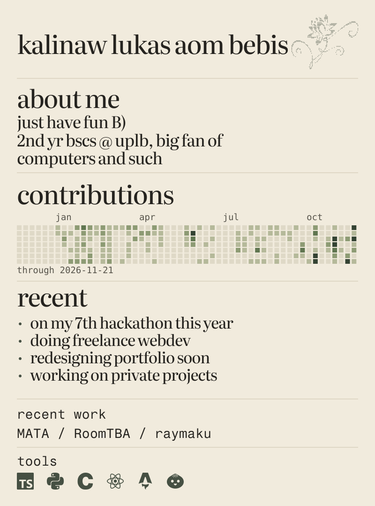

[MATA](https://github.com/klnwlks/MATA-NASASPACEAPPS2026) · [RoomTBA](https://github.com/uplbtools/room-tba) · [raymaku](https://github.com/klnwlks/raymaku) · [Contribution details](https://github.com/klnwlks#js-contribution-activity-description)
